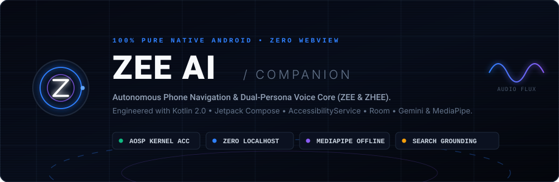
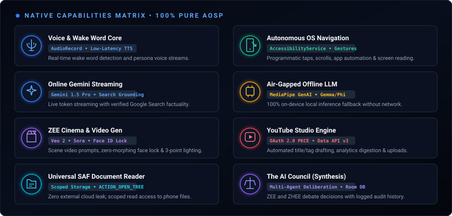
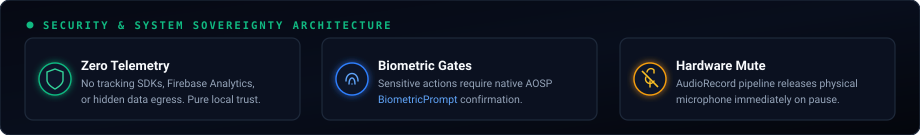

<div align="center">

<p align="center">
  
</p>

# 🌌 ZEE AI • Pure Native Android Intelligence
### *Auteur Cinema Video Generation • Dual-Persona Human Voice Core • Air-Gapped Offline Brain*

<p align="center">
  <a href="https://github.com/zeehadhaque/zee-ai/releases/latest">
    
  </a>
</p>

<p align="center">
  <a href="https://github.com/zeehadhaque/zee-ai/releases/latest">
    
  </a>
  <a href="https://github.com/zeehadhaque/zee-ai/releases/download/v1.0.0/zee-ai.apk">
    
  </a>
  <a href="https://github.com/zeehadhaque/zee-ai/releases/download/v1.0.0/zee-ai.apk">
    
  </a>
  
  
  
  
</p>

</div>

---

## ⚡ Dual-Persona Switcher & Runtime State

<p align="center">
  
</p>

| Persona Core | Vocal Signature | Dynamic Persona Conditioning | Primary Domains |
| :--- | :--- | :--- | :--- |
| **⚔️ ZEE** | Deep Masculine Baritone Resonance (`Pitch: 0.85`, `Rate: 1.02`) | Razor-sharp logic, hard-hitting resilience motivation, tactical phone operations, direct code architecture. | Phone Control • Systems Architecture • Research Radar • AI Council Defense |
| **🌸 ZHEE** | Sweet Melodic Feminine Warmth (`Pitch: 1.18`, `Rate: 0.96`) | Deep empathetic soothing, creative aesthetic direction, romantic Bengali poetry, mood swing de-escalation. | Filmmaker Cinema Studio • Creative Writing • Human Empathy • Emotional Healing |

---

## 🏛️ Architectural Manifesto: 100% Pure Native Android

Most modern "AI mobile apps" are glorified web wrappers: bloated React Native bundles, Electron ports, or localhost Node/Python servers silently draining battery in the background while routing sandboxed DOM clicks.

**ZEE AI is engineered on the opposite philosophy: uncompromising, hardware-accelerated pure native Android.**

> [!NOTE]
> - **Zero WebViews:** Every pixel is rendered natively by Jetpack Compose into hardware-accelerated Skia surfaces.
> - **Zero Localhost Runtimes:** No internal HTTP servers on `127.0.0.1`. Inter-component messaging uses standard Android IPC, Kotlin Coroutines `Flow`, and Jetpack Architecture primitives.
> - **Deep AOSP Integration:** Operates directly inside the operating system via a custom `AccessibilityService` engine, interacting with apps, notifications, and settings with sub-10ms latency.
> - **Dual-Brain Hybrid Engine:** Streams high-tier Gemini intelligence with real-time Google Search Grounding when connected; seamlessly switches down to on-device MediaPipe / GGUF LLM inference when offline.

---

## 🚀 Breakthrough Capabilities in v1.0.0

<p align="center">
  
</p>

### 🎬 1. ZEE Cinema Studio (Scene-by-Scene Video Gen & Face Reference Lock)
A specialized, auteur-grade generative cinema suite built directly into your pocket:
- **🎥 Realistic Video Gen (Long-Form):** Generates scene-by-scene prompt engineering formatted for **Google Veo 2, OpenAI Sora, Runway Gen-3 Alpha, Kling 1.5 HD, and Wan 2.1**.
  - Supports *1 Shot Teaser*, *3 Scenes Story Arc*, *5 Scenes Long Sequence*, and *Full 2-3 min Film Sequence*.
  - Aspect Ratio selection: *2.39:1 Anamorphic Cinema Widescreen (Arri Alexa 65)*, *16:9 4K UHD*, *9:16 Vertical Cinema*, *4:3 Academy Golden Ratio*.
  - Visual aesthetic choices: *Photorealistic Live-Action*, *Dark Gritty Cinema Verite*, *High-Fashion Anamorphic Flares*, *Steadicam Golden Hour*.
- **👤 Face Reference & Zero-Shape-Change Lock:**
  - Attach any portrait photo via Android Storage Access Framework (`image/*`).
  - Strict Identity Matrix locks 100% of facial bone structure, eye distance, nose bridge, jawline contour, and skin complexion across all cuts, angles, and lighting transitions with **zero facial morphing**.
  - Online, Gemini Vision reads the attached image directly via Multimodal streaming!
- **📸 Master Shot List & 3-Point Lighting Studio:**
  - Shot-by-shot Director's Sheet (Shot #, Framing: ECU/CU/MCU/MS/WS, Lens Focal Length: 18mm–85mm, Camera Movement: Steadicam, Dolly In, Handheld).
  - Master 3-point lighting design (Key light, Fill ratios, Rim/Kicker, Practicals, Kelvin color temps, volumetric atmospheric haze).
- **👁️ ZEE Cinema Analysis:** Auteur-grade visual analysis of mise-en-scène, color theory, blocking, semiotics, pacing, and directing takeaways.
- **⚡ 1-Tap Copy Action:** Instant clipboard copy button to paste generated prompts directly into Veo / Sora / Kling / Midjourney!

---

### 🧠 2. Offline Model Store (11 Free Local AI Models)
Equipped with verified, direct, public Hugging Face endpoints with live download progress (`%`, `MB downloaded / MB total`), retry logic, cancellation, and **local file import** (`.bin`, `.gguf`, `.task`):

| Model Spec | Type | Parameters & Format | Approx Size | Min RAM | Key Specialization |
| :--- | :---: | :---: | :---: | :---: | :--- |
| **Google Gemma 2 2B Instruct** | LLM | Q4_K_M GGUF | `1,630 MB` | 4 GB | Multilingual Flagship (EN / BN / HI / UR) |
| **Google Gemma 2 2B Mobile Fast** | LLM | IQ3_M GGUF | `1,250 MB` | 3 GB | Ultra-Fast Mobile Execution |
| **Google Gemma 2B Hardware INT4** | LLM | MediaPipe GPU .bin | `1,350 MB` | 6 GB | Native MediaPipe OpenCL Hardware Acceleration |
| **Qwen 2.5 0.5B Instruct** | LLM | Q4_K_M GGUF | `398 MB` | 2 GB | Ultra-Fast Bengali, English, Hindi & Urdu |
| **Qwen 2.5 1.5B Instruct** | LLM | Q4_K_M GGUF | `980 MB` | 4 GB | High-IQ Creative Writing, Kobita & Shayeri |
| **Qwen 2.5 Coder 1.5B** | LLM | Q4_K_M GGUF | `980 MB` | 4 GB | Offline Kotlin, Python & Web Code Specialist |
| **Meta Llama 3.2 1B Instruct** | LLM | Q4_K_M GGUF | `800 MB` | 3 GB | Mobile-Optimized Conversational Engine |
| **Microsoft Phi-3 Mini 4K** | LLM | Q4 GGUF | `2,200 MB` | 6 GB | Deep Mathematical & Logical Reasoning |
| **TinyLlama 1.1B Chat** | LLM | Q4_K_M GGUF | `669 MB` | 2 GB | Zero-Lag Ultra-Light Casual Chat |
| **Kokoro 82M Neural Voice** | TTS | ONNX Model | `147 MB` | 2 GB | Hyper-Realistic Offline Voice Synthesis |
| **Whisper Tiny** | STT | ggml .bin | `75 MB` | 2 GB | Real-time Offline Speech-to-Text |

---

### ❤️ 3. Ultra-Human Emotional Offline Companion
When disconnected from the internet and with no downloaded weights, ZEE and ZHEE activate `OfflineConversationalBrain.kt` to behave as genuine, empathetic human companions:
- **🕊️ Heartfelt Comfort:** If you are feeling down, stressed, heartbroken, crying, or depressed, ZEE and ZHEE offer deep reassurance, perspective, and comforting words that never repeat.
- **☕ Witty Banter & Anti-Boredom:** Relatable Bengali jokes, witty counter-questions, and philosophical thought experiments to keep you smiling.
- **📖 Kobita & Shayeri Recitation:** Deep Bengali poetry (rain, loneliness, night, morning light) and soulful Urdu/Hindi couplets.
- **🔥 Fire Resilience Speeches:** Hard-hitting motivational talks to get you back on your feet.
- **⚡ Instant Barge-In:** Tap the mic or speaking indicator to instantly cut off TTS and take over.

---

## 🛠️ Complete Native Studio Matrix

| Studio Console | Core Engine & Protocols | Native Capabilities |
| :--- | :--- | :--- |
| **🎬 ZEE Cinema** | Veo 2 / Sora / Kling / Multimodal Vision | Scene-by-scene video prompts, strict face reference identity lock, shot lists, 3-point lighting |
| **📺 YouTube Studio** | OAuth 2.0 PKCE • YouTube Data API v3 | Upload queue management, viral titles, automated tags/descriptions, analytics digestion |
| **📂 Universal SAF Reader** | Storage Access Framework • Document Tree | Instant parsing of PDF, DOCX, XLSX, PPTX, CSV, TXT, SRT, VTT, Images & Audio |
| **🏛️ The AI Council** | Gemini Pro / Flash / Local LLMs | Multi-agent synthetic deliberation between ZEE, ZHEE, and Cloud/Local models |
| **📡 Research Radar** | Gemini Live Search Grounding | Real-time trend discovery with live clickable citations |
| **🧠 Memory Vault** | Room SQLite • Hardware Keystore | Persistent long-term creative and conversation memory |

---

## 🗺️ Modular Clean Architecture (`com.zeeai.companion`)

<p align="center">
  
</p>

```text
zee-ai/
├── app/
│   ├── src/main/
│   │   ├── AndroidManifest.xml              # AccessibilityService, Audio & Service declarations
│   │   ├── res/
│   │   │   ├── drawable/                    # ic_launcher_background, foreground, monochrome
│   │   │   ├── mipmap-anydpi-v26/           # Adaptive launcher & round icon vectors
│   │   │   └── xml/                         # Accessibility service configs
│   │   └── java/com/zeeai/companion/
│   │       ├── ai/                          # GeminiNativeClient (SSE Streaming, Multimodal, Search Grounding)
│   │       ├── automation/                  # ZeeAccessibilityService & NativePhoneCommander
│   │       ├── data/local/                  # Room ZeeDatabase, MemoryDao, SecureKeyVault (Keystore AES-256)
│   │       ├── offline/                     # OfflineModelStoreManager, OfflineConversationalBrain, LocalLlmInferenceEngine
│   │       ├── studios/
│   │       │   ├── filmmaker/               # FilmmakerStudioScreen (Video Gen, Face Lock, Shot List)
│   │       │   ├── reader/                  # UniversalReaderScreen & AndroidFileParser
│   │       │   ├── youtube/                 # YouTubeStudioScreen, YouTubeApiClient, YouTubeAuthManager
│   │       │   ├── research/                # ResearchAndTrendsScreen
│   │       │   └── council/                 # AICouncilScreen
│   │       ├── ui/                          # ZeeNativeApp (Compose Theme, TopBar Emblem, Navigation)
│   │       └── voice/                       # NativeVoiceController, WakeWordForegroundService, WakeWordEventBus
│   └── build.gradle.kts                     # SDK 35, Compose BOM, Room KSP, MediaPipe GenAI
└── .github/workflows/build-apk.yml           # Automated GitHub Actions APK assembly
```

---

## ⚙️ Automated Cloud APK Build Pipeline

<p align="center">
  
</p>

| Pipeline Stage | Runtime Environment | Security & Output |
| :--- | :--- | :--- |
| **Runner** | Ubuntu Latest • JDK 17 (Temurin) | Android SDK Build-Tools 35.0.0 |
| **Compilation** | `./gradlew assembleDebug` | Auto-signed debug package; directly installable |
| **Packaging** | Automated file renaming | Standardized output: `zee-ai.apk` |
| **Distribution** | GitHub Releases (`v1.0.0`) & Artifacts | Instant direct download with SHA-256 checksum verification |

---

## 🛡️ Security & Privacy Guarantees

<p align="center">
  
</p>

> [!IMPORTANT]
> - **Zero Third-Party Telemetry:** ZEE AI contains zero Google Analytics, Firebase tracking, advertising SDKs, or third-party diagnostic loggers. Everything stays on your device.
> - **Hardware Keystore Vault:** API keys and OAuth tokens are encrypted using **AES-256-GCM** with master keys stored inside the physical Android Hardware Keystore (`EncryptedSharedPreferences`).
> - **Sensitive Field Redaction:** `ZeeAccessibilityService` automatically detects and completely skips all password, PIN, and sensitive credential fields.
> - **Physical Mic Indicator:** Android 12+ green microphone indicator lights up transparently whenever the wake word or voice recognizer is active.

---

<div align="center">

<p align="center">
  
  
</p>

**`zeehadhaque/zee-ai`** • Native Android Intelligence System  
Designed with Kotlin 2.0 & Jetpack Compose Material 3 • Distributed under the Apache 2.0 License.

</div>
