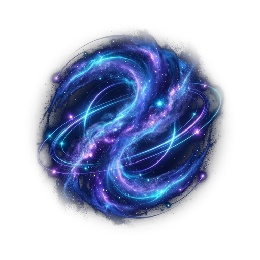
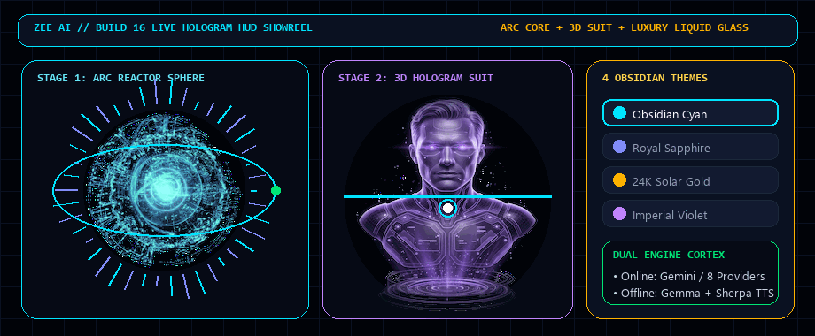
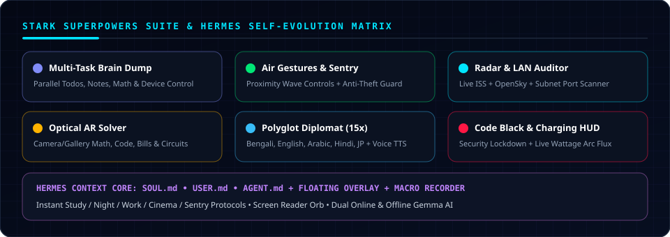
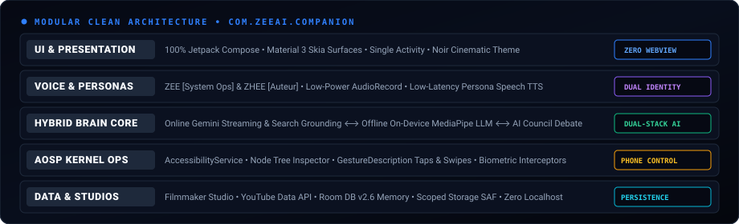
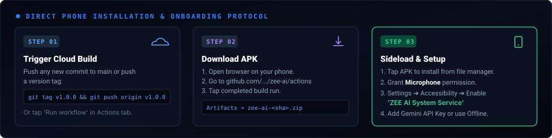

<div align="center">

<p align="center">
  
</p>

<p align="center">
  
</p>

# 🌌 ZEE AI • Pure Native Android Intelligence (Build 16)
### *Obsidian Luxury Liquid Glass • Interactive 3D Arc Reactor & Suit Bust HUD • 9 Stark Superpowers • On-Device Gemma*

<p align="center">
  <a href="https://github.com/zeehadhaque/zee-ai/releases/download/v1.0.0/ZeeAi.apk">
    
  </a>
</p>

<p align="center">
  <a href="https://github.com/zeehadhaque/zee-ai/releases/download/v1.0.0/ZeeAi.apk">
    
  </a>
  <a href="https://github.com/zeehadhaque/zee-ai/releases/tag/v1.0.0">
    
  </a>
  
  
  
  
</p>

</div>

<p align="center">
  
</p>

## ⚡ Live 3D Hologram HUD & Dual-Stage Showreel

<p align="center">
  
</p>

> [!TIP]
> Switch instantaneously across **Agent Mode**, **Chat Mode**, and **3D ZEE HUD** via the **Liquid Glass Segmented Mode Switcher** (`LiquidGlassModeSwitcher`) with tactile haptic feedback and AMOLED-grade `#02040A` obsidian contrast.

---

## 🎨 Obsidian Luxury Liquid Glass Theme Engine

Designed in [`LuxuryGlassTheme.kt`](app/src/main/java/com/zeeai/companion/ui/theme/LuxuryGlassTheme.kt) & [`LuxuryGlassComponents.kt`](app/src/main/java/com/zeeai/companion/ui/components/LuxuryGlassComponents.kt) with refractive ambient background orbs, translucent smoked-crystal surfaces (`#131B2E` → `#070C17`), specular rim borders, and 4 hot-swappable luxury palettes:

| Luxury Theme Preset | Color Swatch | Primary Hex | Secondary Hex | Vibe & Accent Spec |
| :--- | :---: | :---: | :---: | :--- |
| **🔹 Obsidian Cyan** |  | `#00E5FF` | `#6366F1` | Stark Cybernetic Holo Glass (Default) |
| **💠 Royal Sapphire** |  | `#818CF8` | `#4F46E5` | Executive Deep-Indigo Crystal |
| **✨ 24K Solar Gold** |  | `#FFB300` | `#D97706` | Titanium Reactor Champagne Gold |
| **🔮 Imperial Violet** |  | `#C084FC` | `#7C3AED` | Quantum Amethyst Holography |

### 🌈 Dynamic 5-State HUD Aura Morphing
* 🔵 **Idle (`Accent`)**: Gentle core breathing + slow 3-axis armillary gyroscope rotation
* 🟢 **Listening (`#00E676`)**: Real-time microphone RMS amplitude drives the 42-bar 360° equalizer
* 🟡 **Thinking / Executing (`#FFB300`)**: Accelerated golden core spin & shockwave telemetry ripple
* 🟣 **Speaking (`#818CF8` ↔ `#BA68C8`)**: Violet hologram cross-fade & vocal waveform pacing
* 🔴 **Code Black (`#FF1744`)**: Full-screen tactical crimson lockdown with tamper detection

---

<p align="center">
  
</p>

## 🚀 9 Stark Superpowers & Hermes Self-Evolution

<p align="center">
  
</p>

| Superpower | Icon | Engine Class & Real Capabilities |
| :--- | :---: | :--- |
| **Multi-Task Brain Dump** | 🧠 | Splits compound voice/text instructions into Todos, Calendar Reminders, Notes, Math, Drafts & Device Actions — executed in parallel via Kotlin coroutines (`async`/`awaitAll`). |
| **Zero-Touch Air Gestures** | 👋 | Uses hardware proximity sensor waves (`wave` → Next Track, `palm_hover` → Play/Pause, `double_wave` → Screenshot) + Sonar HUD simulator. |
| **Tactical Sentry Watchdog** | 🚨 | Accelerometer motion detector that guards your device when idle, logs unauthorized touches, and issues an immediate spoken Boss alert. |
| **Orbital & Airspace Radar** | 🛰️ | Live orbital **ISS (Zarya)** telemetry (`open-notify.org`) + **OpenSky ADS-B** aircraft callsigns, altitude, speed & heading on a sweeping radar scope. |
| **LAN Security Auditor** | 🛡️ | Enumerates local IPv4 interface, `/proc/net/arp`, and probes common ports (`21, 22, 23, 80, 443, 554, 8080, 8123`), surfacing security posture score (`0–100`) & risk flags. |
| **Optical AR Solver** | 📸 | Sweeping gold reticle viewfinder supporting **Camera Photo (`FileProvider`)**, **Gallery**, and **Auto / Math / Code / Bills / Hardware** solving via multimodal Gemini or offline math. |
| **Polyglot Diplomat** | 🌍 | Instant translation across **15 languages** (Bengali, English, Hindi, Arabic, Spanish, French, Japanese, German, Korean, Italian, Portuguese, Russian, Chinese, Turkish, Urdu) with native TTS. |
| **Arc Reactor Charging HUD** | ⚡ | Triggers on charger connect (`ACTION_POWER_CONNECTED`) or via Action Pod, displaying counter-rotating stators, Wattage (`W`), Voltage (`V`), Current (`mA`), and Temperature (`°C`). |
| **Code Black Lockdown** | 🔒 | Full-screen CRT scanline terminal lockout with tap tamper logging & vibration — unlockable via 4-tap secret top-right corner, bottom long-press/double-tap, or voice override. |
| **Floating Overlay Orb** | 🫧 | Draggable Arc-Reactor bubble over every app (`TYPE_APPLICATION_OVERLAY`) with **Read Screen** Accessibility readout & 1-tap Voice HUD launch. |
| **Hermes Context Core** | 🧬 | Self-evolves `SOUL.md`, `USER.md`, and `AGENT.md` with an in-app Markdown editor + 1-tap **Study**, **Night**, **Work**, **Cinema**, and **Sentry** hardware protocols. |

---

<p align="center">
  
</p>

## ⚡ Dual-Persona Loyal "বস (Boss)" Voice Core

<p align="center">
  
</p>

| Companion Persona | Signature Tone & Voice Engine | Calibration & Loyalty Behavior |
| :--- | :--- | :--- |
| **⚔️ ZEE (Male)** | Crisp masculine baritone (`Pitch: 0.85`, `Rate: 1.02`) • Sherpa-ONNX / Studio TTS | Crisp execution, loyal tactical telemetry, hardware automation, coding & research — always addresses you respectfully as **"বস" (Boss)**. |
| **🌸 ZHEE (Female)** | Warm expressive feminine cadence (`Pitch: 1.18`, `Rate: 0.96`) • Sherpa-ONNX / Studio TTS | Warm empathy, emotional intelligence awareness, storytelling, cinema directing & planning — always replies warmly to **"বস" (Boss)**. |

### 🎛️ Dual-Box Model Selector & 8 AI Providers
* **🌐 Box 1 — Online Cortex:** Pick **Google Gemini** (`gemini-2.0-flash`, `1.5-flash`, `1.5-pro`), or configure presets in *Core Settings* for **DeepSeek**, **OpenAI**, **Groq**, **OpenRouter**, **NVIDIA NIM**, **Ollama (Local)**, or **Custom OpenAI Endpoints**.
* **📴 Box 2 — Offline Cortex:** Auto-scans on-device `.task` / `.bin` / `.gguf` models (`OfflineModelResolver`, zero `"Model Not Found"` stalls) + built-in **Model Downloader** & **Sherpa-ONNX Neural Voice Packs**.
* **📱 Dual Phone Control Dashboard:** Instant `<50ms` offline hardware toggles (Torch, Volume, Screenshot, Wi-Fi, Bluetooth, Alarms, Timers) alongside Smart App Launchers & **Macro Recorder** (`MACRO_START`/`MACRO_STOP`).

---

## 💬 Voice & Command Cheatsheet (Bengali • Banglish • English)

| What You Say / Type | What ZEE / ZHEE Executes Instantly |
| :--- | :--- |
| `"Torch on kor"` / `"লাইট জ্বালাও"` | Toggles hardware camera LED via `CameraManager.setTorchMode` (`<50ms`) |
| `"Study mode"` / `"Night mode"` / `"Cinema mode"` | Triggers **Hermes Protocol** (volume profile, torch off, sentry check) |
| `"Code black"` / `"লকডাউন"` | Engages full-screen **Code Black** security terminal lockdown |
| `"Read my screen"` / `"স্ক্রিন পড়"` | Captures foreground Accessibility UI hierarchy and reads/speaks summary |
| `"Remind me 5pm call & add buy coffee todo & wifi?"` | Fires **Multi-Task Brain Dump** across calendar, tasks & settings in parallel |
| `"YouTube khule de"` / `"Call Ammu"` | Opens target app or places call via Accessibility & native Contacts resolution |

---

## 🛠️ Complete Native Studios, Productivity & Architecture

<p align="center">
  
</p>

| Module / Suite | Package | Native Capabilities |
| :--- | :--- | :--- |
| **🎭 Productivity Suite** | `ui/jarvis/` | **Tasks & Todos Matrix**, **Calendar & Reminders** (in-app + native Intent), **Knowledge Notes Vault**, **Mission Session Logs** |
| **🎬 ZEE Cinema Studio** | `studios/filmmaker/` | Multi-scene video prompts (Veo 2 / Sora / Kling), strict facial identity lock, shot list, 3-point lighting |
| **📺 YouTube Automation** | `studios/youtube/` | OAuth 2.0 PKCE + YouTube Data API v3, viral titles, tags, descriptions & analytics |
| **⚖️ AI Council & Radar** | `studios/council/`, `research/` | Multi-model council deliberation + Gemini Search grounded live trend research |
| **📂 Universal SAF Reader** | `studios/reader/` | Local parsing of PDF, DOCX, XLSX, PPTX, CSV, TXT, SRT, VTT, Images & Audio |
| **🔐 Permissions Hub** | `PermissionsHubScreen` | Live status tracker & 1-tap links for Mic, Accessibility, Overlay, Notification Listener, Contacts, Battery & Usage Stats |

<p align="center">
  
</p>

```text
zee-ai/
├── assets/                                  # Animated SVG banners, neon dividers & live HUD GIF showreel
├── app/src/main/
│   ├── AndroidManifest.xml                  # Clean Play-Protect-safe permissions, FileProvider & Services
│   ├── res/drawable-nodpi/                  # 3D Arc Reactor & Suit Bust holograms + ZEE Brand Emblem
│   └── java/com/zeeai/companion/
│       ├── ai/                              # GeminiNativeClient, UnifiedCommandAndChatRouter (8 Providers)
│       ├── automation/                      # ZeeAccessibilityService (Macros & Screen Snapshot), Phone Controllers
│       ├── data/local/                      # Room ZeeDatabase, MemoryDao, AES-256-GCM SecureKeyVault
│       ├── jarvis/                          # JarvisCoreController, StarkSuperpowersEngine, HermesEvolutionEngine,
│       │                                    # HardwareSensorsController, ZeeFloatingOverlayService, ProductivityStore
│       ├── offline/                         # OfflineModelResolver, OfflineModelStoreManager, LocalLlmInferenceEngine
│       ├── studios/                         # Cinema, YouTube, Research Radar, AI Council, Universal SAF Reader
│       ├── ui/
│       │   ├── theme/                       # LuxuryGlassTheme (Obsidian Cyan, Sapphire, 24K Gold, Imperial Violet)
│       │   ├── components/                  # LiquidGlassModeSwitcher, LuxuryGlassCard, LuxuryChatBubble
│       │   ├── hud/                         # ZeeHologramHud (Arc Reactor + 3D Suit Bust, 42-bar spectrum)
│       │   ├── jarvis/                      # Stark Superpowers Dialogs, Code Black, Permissions Hub, Core Settings
│       │   └── ZeeNativeApp.kt              # Main Compose Shell & Dual-Box Architecture
│       └── voice/                           # NativeVoiceController, ZeeVoiceInputController, Sherpa-ONNX, WakeWord
└── build.gradle.kts                         # compileSdk 35, Compose BOM 2024.10.01, Room, MediaPipe GenAI
```

---

## 🛡️ Security, Privacy & Installation

<p align="center">
  
</p>

> [!IMPORTANT]
> - **Zero Play-Protect Red Flags:** Avoids risky `READ_SMS`, `SEND_SMS`, `QUERY_ALL_PACKAGES`, `CAMERA` runtime permission abuse, or `MANAGE_EXTERNAL_STORAGE`. Uses Android `<queries>`, `NotificationListenerService`, and `FileProvider` camera intents cleanly.
> - **Hardware Keystore Encryption:** API keys & OAuth tokens live inside AES-256-GCM `EncryptedSharedPreferences`.
> - **Sensible Field Redaction:** `ZeeAccessibilityService` skips password/PIN fields during macros & screen snapshots.

<p align="center">
  
</p>

### 📦 Quick Install (Build 16 — `v1.0.0`)
1. Download [**`ZeeAi.apk`**](https://github.com/zeehadhaque/zee-ai/releases/download/v1.0.0/ZeeAi.apk) (`66.1 MiB` • `versionCode = 16`).
2. Install directly over Build 15 (`com.zeeai.companion` • officially signed with `zee_release_key`) without losing settings or offline models.
3. Open **Drawer → Permissions Hub** to enable **Microphone**, **Accessibility**, **Floating Overlay**, and **Notification Listener** in under 30 seconds.

---

<div align="center">

<p align="center">
  
  
</p>

**`zeehadhaque/zee-ai`** • Obsidian Luxury Liquid Glass Android Intelligence  
Built with Kotlin 2.0, Jetpack Compose Material 3 & MediaPipe On-Device GenAI.

</div>
