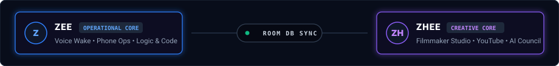
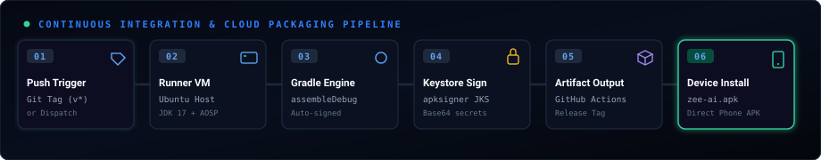

<div align="center">

<p align="center">
  
</p>

<p align="center">
  <a href="https://github.com/zeehadhaque/zee-ai">
    
  </a>
</p>

<p align="center">
  
  
  
  
  
  
  
</p>

</div>

---

### Dual Persona Switcher & Runtime State

<p align="center">
  
</p>

---

## Architectural Manifesto

Most modern "AI mobile apps" are thin web wrappers: React Native bundles, Electron ports, or localhost Node/Python servers silently draining battery in the background while routing sandboxed DOM clicks.

**ZEE AI is engineered on the opposite philosophy: 100% pure native Android.**

> [!NOTE]
> - **Zero WebViews:** Every pixel is rendered by Jetpack Compose into hardware-accelerated Skia surfaces.
> - **Zero Localhost Runtimes:** No internal HTTP servers running on `127.0.0.1`. Inter-component messaging uses standard Android IPC, Kotlin Coroutines `Flow`, and Jetpack Architecture primitives.
> - **Deep Android Integration:** Operates directly inside the operating system via a custom `AccessibilityService` engine, interacting with apps, notifications, and settings natively.
> - **Dual-Brain Hybrid Engine:** Streams high-tier Gemini intelligence with real-time Google Search Grounding when connected; seamlessly switches down to on-device MediaPipe LLM inference when offline.

---

## Core Feature Matrix & Native Architecture

<p align="center">
  
</p>

| Module / System | Native Android API & Engine | Operational Capability | Redundancy & Security Boundary |
| :--- | :--- | :--- | :--- |
| **🎙️ Voice & Wake Word** | `AudioRecord` • Low-Latency ASR • `android.speech.tts.TextToSpeech` | Real-time wake detection, streaming speech recognition, and instant persona-conditioned vocal responses. | Runs entirely within foreground service; zero audio egress unless conversational query is dispatched. |
| **📱 Autonomous Phone Control** | `AccessibilityService` • `GestureDescription` • Node Tree Inspection | Inspects live AOSP UI hierarchies, executes programmatic taps, scrolls, text insertion, app launching, and automated workflows. | Destructive actions require explicit on-screen visual confirmation or biometric authentication (`BiometricPrompt`). |
| **⚡ Online Intelligence** | Official Google GenAI SDK (Gemini 1.5 Pro / Flash) | Streaming tokens, multimodality, dynamic context caching, and real-time Google Search Grounding for verified factual synthesis. | Enforces strict payload sanitization; API keys isolated in encrypted Keystore-backed `EncryptedSharedPreferences`. |
| **🛡️ On-Device Offline Brain** | Google MediaPipe LLM Inference Engine (`Gemma-2B` / `Phi-2` .bin) | Zero-network fallback. Instant local creative drafts, shell commands, device diagnostics, and emergency voice responses. | 100% air-gapped on-device compute. Zero telemetry or external network calls made while operating in offline mode. |
| **🎬 Filmmaker Studio** | Native Canvas • MediaPipe Image Embedder • Room DB | Cinematographic storyboard drafting, scene-by-scene script breakdown, shot deck lighting presets, and camera angle directors. | Local SQLite database persistence via Room; cached assets saved to app-scoped isolated media sandboxes. |
| **📺 YouTube Studio Engine** | Direct Google OAuth 2.0 PKCE • YouTube Data API v3 | Upload queue management, automated title/tag/description drafting, engagement analytics digestion, and thumbnail verification. | Scoped OAuth permissions; refresh tokens held exclusively inside hardware-backed Android Keystore. |
| **📂 Universal SAF Reader** | Storage Access Framework (`Intent.ACTION_OPEN_DOCUMENT_TREE`) | Scoped read access to device logs, scripts, text corpora, raw PDFs, and project directories without legacy file permission hazards. | Operates under strict Android 14+ Scoped Storage guidelines; never requests legacy `MANAGE_EXTERNAL_STORAGE`. |
| **⚖️ The AI Council** | Multi-Agent Synthetic Deliberation Matrix | ZEE and ZHEE cross-examine arguments, debate engineering or artistic trade-offs, and generate arbitrated decisions. | Synthesized in local memory queues; verdicts logged to persistent Room DB tables with full rationale history. |

---

## Project Structure (`com.zeeai.companion`)

```text
zee-ai/
├── app/
│   ├── src/
│   │   ├── main/
│   │   │   ├── AndroidManifest.xml              # AccessibilityService, Audio & Service declarations
│   │   │   ├── res/                             # Vector drawables, raw configs & theme values
│   │   │   └── java/com/zeeai/companion/
│   │   │       ├── accessibility/               # Native OS Accessibility Control
│   │   │       │   ├── ZeeAccessibilityService.kt   # System event observer & Node tree traverser
│   │   │       │   ├── ActionExecutor.kt            # Dispatcher for taps, swipes & gestures
│   │   │       │   └── UIHierarchyScanner.kt        # AccessibilityNodeInfo extractor & parser
│   │   │       ├── ai/                          # Dual Brain Orchestration
│   │   │       │   ├── online/                  # Gemini streaming & Search Grounding
│   │   │       │   │   ├── GeminiClient.kt
│   │   │       │   │   └── SearchGroundingWrapper.kt
│   │   │       ├── offline/                 # On-device MediaPipe & LiteRT inference
│   │   │       │   ├── MediaPipeEngine.kt
│   │   │       │   └── ModelDownloader.kt
│   │   │       └── council/                 # Multi-persona debate arbitration
│   │   │           └── CouncilOrchestrator.kt
│   │   │       ├── data/                        # Persistence & System Repositories
│   │   │       │   ├── local/                   # Room DB entities & DAOs
│   │   │       │   ├── ZeeDatabase.kt
│   │   │       │   ├── MemoryDao.kt
│   │   │       │   └── ConversationEntity.kt
│   │   │       └── repository/              # Unified AI & Device Repository bindings
│   │   │       ├── persona/                     # Identity, Voices & Prompt Profiles
│   │   │       │   ├── PersonaManager.kt        # ZEE vs. ZHEE voice/behavior switch engine
│   │   │       │   ├── ZeePersona.kt            # System Architect persona definition
│   │   │       │   └── ZheePersona.kt           # Cinematic Auteur persona definition
│   │   │       ├── studio/                      # Creative & Integration Tooling
│   │   │       │   ├── filmmaker/               # Storyboarding, scene decks & scripts
│   │   │       │   ├── youtube/                 # YouTube Data API client & metrics
│   │   │       │   └── saf/                     # Storage Access Framework document reader
│   │   │       ├── voice/                       # Audio Capture & Text-to-Speech
│   │   │       │   ├── HotwordDetector.kt       # Continuous low-power listening
│   │   │       │   ├── VoiceRecorder.kt         # AudioRecord PCM stream processor
│   │   │       │   └── SpeechSynthesizer.kt     # Low-latency persona TTS engine
│   │   │       └── ui/                          # 100% Jetpack Compose / M3 Interface
│   │   │           ├── theme/                   # Noir Obsidian color palette & typography
│   │   │           ├── components/              # Animated waveforms, radar reticles, meters
│   │   │           ├── screens/                 # Chat, Council, Studio & Accessibility consoles
│   │   │           └── MainActivity.kt          # Single-Activity compose root
│   │   └── test/                                # Unit tests (JUnit 5 + MockK)
│   └── build.gradle.kts                         # Android build config & dependency tree
├── .github/
│   └── workflows/
│       └── build-apk.yml                        # Cloud automated APK build pipeline
├── assets/
│   ├── hero-banner.svg                          # Keyframe animated Obsidian Noir SVG banner
│   ├── persona-status.svg                       # Live dual-persona state indicator
│   ├── feature-matrix.svg                       # Visual capabilities matrix with vector cards
│   └── pipeline.svg                             # Animated cloud APK build & CI/CD pipeline
├── build.gradle.kts                             # Top-level Gradle script
└── settings.gradle.kts
```

---

## Automated Cloud APK Build & Pipeline

No Android Studio or local toolchain required to compile release builds. The repository includes a GitHub Actions continuous integration pipeline that compiles, signs, and packages release APKs directly in the cloud.

<p align="center">
  
</p>

### GitHub Actions Workflow: `.github/workflows/build-apk.yml`

```yaml
name: Build & Package Zee AI APK

on:
  push:
    branches: [ "main" ]
    tags: [ "v*" ]
  workflow_dispatch:

concurrency:
  group: ${{ github.workflow }}-${{ github.ref }}
  cancel-in-progress: true

jobs:
  build:
    name: Assemble & Sign Android APK
    runs-on: ubuntu-latest

    steps:
      - name: Checkout Source Code
        uses: actions/checkout@v4
        with:
          fetch-depth: 0

      - name: Set up Java Development Kit (JDK 17)
        uses: actions/setup-java@v4
        with:
          distribution: 'temurin'
          java-version: '17'
          cache: 'gradle'

      - name: Grant Execute Permission to Gradle Wrapper
        run: chmod +x gradlew

      - name: Compile Release APK
        run: ./gradlew assembleRelease --stacktrace --no-daemon

      - name: Sign APK (Production / Debug Fallback)
        id: sign_apk
        env:
          KEYSTORE_BASE64: ${{ secrets.ANDROID_KEYSTORE_BASE64 }}
          KEY_ALIAS: ${{ secrets.ANDROID_KEY_ALIAS }}
          KEYSTORE_PASSWORD: ${{ secrets.ANDROID_KEYSTORE_PASSWORD }}
          KEY_PASSWORD: ${{ secrets.ANDROID_KEY_PASSWORD }}
        run: |
          if [ -n "$KEYSTORE_BASE64" ]; then
            echo "[*] Decoding production signing keystore..."
            echo "$KEYSTORE_BASE64" | base64 --decode > app/keystore.jks
            $ANDROID_HOME/build-tools/34.0.0/apksigner sign \
              --ks app/keystore.jks \
              --ks-key-alias "$KEY_ALIAS" \
              --ks-pass pass:"$KEYSTORE_PASSWORD" \
              --key-pass pass:"$KEY_PASSWORD" \
              --out app/build/outputs/apk/release/zee-ai-release-signed.apk \
              app/build/outputs/apk/release/app-release-unsigned.apk
            echo "apk_path=app/build/outputs/apk/release/zee-ai-release-signed.apk" >> $GITHUB_OUTPUT
          else
            echo "[!] No signing keystore secret detected. Outputting unsigned build artifact."
            cp app/build/outputs/apk/release/app-release-unsigned.apk app/build/outputs/apk/release/zee-ai-release-unsigned.apk
            echo "apk_path=app/build/outputs/apk/release/zee-ai-release-unsigned.apk" >> $GITHUB_OUTPUT
          fi

      - name: Upload APK to Artifacts
        uses: actions/upload-artifact@v4
        with:
          name: zee-ai-${{ github.sha }}
          path: ${{ steps.sign_apk.outputs.apk_path }}
          retention-days: 14

      - name: Create GitHub Release (Git Tag Only)
        if: startsWith(github.ref, 'refs/tags/v')
        uses: softprops/action-gh-release@v2
        with:
          files: ${{ steps.sign_apk.outputs.apk_path }}
          draft: false
          prerelease: false
          generate_release_notes: true
```

### Direct Phone Installation Guide

1. **Trigger Cloud Build:** Push a new commit to `main`, push a release tag (e.g. `git tag v1.0.0 && git push origin v1.0.0`), or tap **Run workflow** under the **Actions** tab on GitHub.
2. **Download Artifact:**
   - On your Android phone, open Chrome and navigate to `https://github.com/zeehadhaque/zee-ai/actions`.
   - Tap the completed workflow run.
   - Under the **Artifacts** section at the bottom, tap `zee-ai-<sha>` to download the compressed `.zip` containing the APK.
3. **Sideload & Permissions:**
   - Extract the `.zip` archive using your device file manager and tap `zee-ai-release.apk`.
   - Allow installation from unknown sources if prompted by Android package installer.
   - On first launch:
     1. Grant **Microphone** permission (required for hotword recognition and speech streaming).
     2. Open **Android Settings → Accessibility → Downloaded Apps → Enable 'ZEE AI System Service'** (required for native phone control).
     3. Insert your Gemini API Key in **Settings → Neural Engine** (or let the app default to the on-device MediaPipe model).

---

## Security & Sovereignty Principles

- **Zero Telemetry:** ZEE AI contains no third-party tracking libraries, Firebase Analytics, crash loggers, or advertisement SDKs.
- **Biometric Action Interceptors:** Any AccessibilityService action that accesses payment gateways, changes lock screen settings, or uninstalls applications triggers an obligatory hardware `BiometricPrompt` before the gesture is executed.
- **Physical Mute:** The audio recording pipeline uses standard Android audio notification icons; when paused, the foreground service releases the hardware microphone immediately.

---

<div align="center">

**`zeehadhaque/zee-ai`** • Native Android Intelligence System  
Designed with Kotlin &amp; Material 3 • Distributed under the Apache 2.0 License.

</div>
